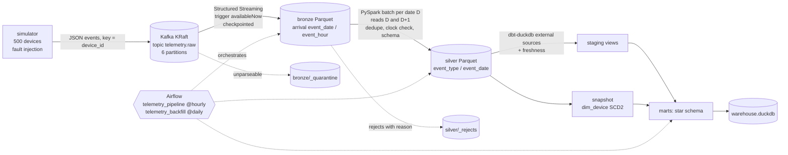
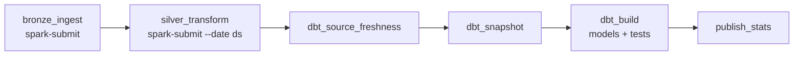
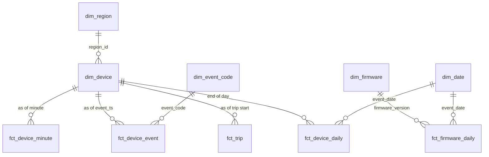
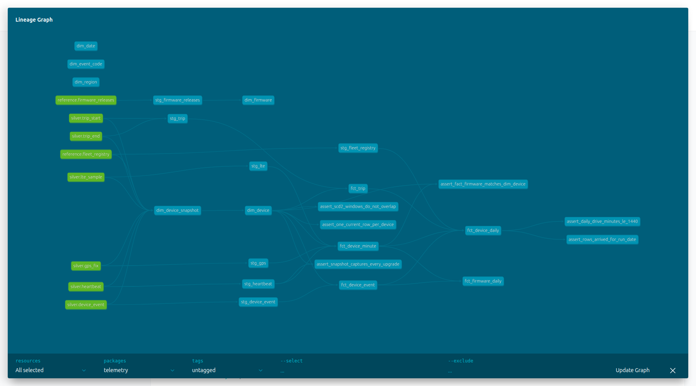

# IoT Telemetry Data Platform

[](https://github.com/jaypp52/telemetry-data-platform/actions/workflows/ci.yml)

An end-to-end batch + streaming pipeline for **simulated** connected-vehicle device
telemetry: a Python simulator publishes events to **Kafka**, **PySpark** lands them as
partitioned **Parquet** (bronze -> silver), **dbt** (on DuckDB) builds a tested **star
schema** with an **SCD Type 2** device dimension, and **Airflow** orchestrates the whole
chain with idempotent backfills. One command (`make up`) brings the stack up in Docker.

All data is synthetic. Device models, regions and event codes are invented for this project.

## Contents

- [Architecture](#architecture)
- [Quickstart](#quickstart)
- [Results](#results)
- [Data model](#data-model)
- [Data quality](#data-quality)
- [Idempotency and backfills](#idempotency-and-backfills)
- [Design decisions](#design-decisions)
- [Resources](#resources)
- [Tests and CI](#tests-and-ci)
- [Limitations](#limitations)
- [Repository layout](#repository-layout)

## Architecture



| Layer | Storage | Written by | Contents |
|---|---|---|---|
| Bronze | `data/lake/bronze/telemetry/event_date=…/event_hour=…/` | Spark Structured Streaming, `availableNow` | raw JSON string + Kafka metadata (topic, partition, offset, `kafka_ts`) + `ingest_ts`, partitioned by **arrival** time |
| Silver | `data/lake/silver/<event_type>/event_date=…/` | PySpark batch, one run per event date | parsed, typed, deduplicated, clock-checked events + lineage columns |
| Gold | `data/warehouse.duckdb` (schemas `marts`, `snapshots`, `staging`) | dbt (`dbt-duckdb`) | star schema, SCD2 snapshot, daily aggregates |

Airflow DAG (`dags/telemetry_pipeline.py`), every task templated on `{{ ds }}`:



`retries=2`, `retry_delay=2 min`, an `execution_timeout` per task and an
`on_failure_callback` that logs one summary line (and posts it to `ALERT_WEBHOOK_URL` if set).

## Quickstart

Requirements: Docker with Compose v2.20+, GNU make, Python 3 on the host (only for the
memory sampler), about 12 GB free disk (the image is ~4.3 GB) and 16 GB RAM
(see [Resources](#resources)).

```bash
cp .env.example .env            # optional: every value has a default
make up                         # build image, start Kafka + Postgres + Airflow, create topic, dbt deps + seeds
make simulate DAYS=7            # publish 7 days of history for 500 devices to Kafka
make backfill START=2026-01-01 END=2026-01-07   # Airflow backfill: bronze -> silver -> dbt, timed
make idempotency-demo           # run the same backfill twice and compare checksums
make stats                      # data/stats/stats.json + regenerate the Results table below
make dbt-docs                   # dbt docs (open dbt/target/static_index.html)
make live                       # continuous simulator + unpause the hourly DAG
make down                       # stop (data kept); `make clean` wipes ./data and volumes
```

Airflow UI: <http://localhost:8080> (admin / admin; set `AIRFLOW_PORT` in `.env` if 8080 is taken).
`make help` lists every target. `make test`, `make lint` and `make ci-dbt` run the CI
checks inside the image.

## Results

Every number in this section is written by `make stats` (`scripts/stats.py`) from the
pipeline's own run reports, the warehouse and dbt's artifacts. None are typed by hand.
Lake and warehouse totals include a few minutes of live-mode data on top of the 7-day
history; the live rate is what 500 devices actually emit at that UTC hour (trips follow
local daytime in five time zones), measured over a 5-minute `--duration-min` run.

<!-- stats:start -->
| Metric | Value |
|---|---|
| Simulated fleet | 500 devices, 7.0 days from 2026-01-01 |
| Events generated / messages sent | 951,984 / 956,823 |
| Simulator throughput (historical) | 69,713.0 msg/s |
| Simulator rate (live mode) | 2.4 events/s |
| Faults injected | clock_error 1,910, duplicate 4,839, late 9,617, malformed 117 |
| Bronze rows (quarantined malformed) | 958,896 (117) |
| Silver rows | 952,135 |
| Duplicates removed | 4,847 |
| Late events (recovered from the next day's bronze) | 10,223 (1,015) |
| Rejects by reason | clock_before_2020 931, clock_in_future 983 |
| dbt project | 15 models, 1 snapshot, 2 seeds, 129 tests |
| Last `dbt build` | pass 129, success 18 |
| Warehouse rows: fct_device_minute / fct_device_daily | 311,423 / 3,337 |
| dim_device rows (SCD2 versions) | 903 |
| 7-day backfill runtime: 1st / 2nd run | 9.5 min / 9.2 min |
| Second backfill identical (row counts + checksums) | yes |
| Peak container memory during the backfill | 4,417 MiB |

CAM_CRASH rate per 100 device-days (from `marts.fct_firmware_daily`):

| Hardware | Firmware | Crashes / 100 device-days |
|---|---|---|
| TX-100 | 1.0.0 | 4.75 |
| TX-100 | 1.1.0 | 4.78 |
| TX-200 | 1.0.0 | 3.07 |
| TX-200 | 1.1.0 | 7.96 |
| TX-300 | 1.0.0 | 4.94 |
| TX-300 | 1.1.0 | 4.15 |

_Generated by `make stats` at 2026-11-23T16:29:58+00:00 from `data/stats/stats.json`._
<!-- stats:end -->

## Data model



| Model | Type | Grain |
|---|---|---|
| `dim_device` | SCD2 dimension (from `dbt snapshot`) | device x firmware validity window (`valid_from`, `valid_to`, `is_current`) |
| `dim_firmware` | dimension | firmware version (release date, `is_latest`) |
| `dim_date` | dimension (`dbt_utils.date_spine`) | calendar day |
| `dim_event_code`, `dim_region` | seeds | event code, region |
| `fct_device_minute` | fact | device x minute with ignition on (heartbeat + LTE + GPS joined) |
| `fct_device_event` | fact | device event |
| `fct_trip` | fact | trip (duration, distance, average speed) |
| `fct_device_daily` | aggregate fact | device x day |
| `fct_firmware_daily` | aggregate fact | firmware x hardware model x day |

Metric definitions live in the dbt column descriptions (`dbt/models/marts/_marts.yml`),
because the companion Text-to-SQL agent reads them:

- `lte_loss_pct` = minutes with `registered = false OR ip_assigned = false` / drive minutes x 100
- `gps_valid_pct` = minutes with `fix_valid = true` / drive minutes x 100
- `crash_rate_per_100_device_days` = CAM_CRASH events / device-days x 100

Facts join `dim_device` **as of event time**:
`event_ts >= valid_from and event_ts < valid_to`. A singular test checks that the window
picked always carries the firmware the device itself reported.

The lineage graph below is a screenshot of `dbt docs` (`docs/lineage.png`):



## Data quality

**Simulated faults** (each is a CLI flag, see `python -m simulator.produce --help`):
firmware 1.1.0 doubles `CAM_CRASH` on hardware model TX-200; 3% of devices have a bad
modem; an LTE dead zone near San Francisco drops every device inside it; and on the
delivery side about 0.5% duplicates, 1% late arrivals (10 min to 6 h), 0.2% device-clock
errors (1970 or the future) and about 0.01% truncated JSON.

**How the pipeline handles them:**

| Fault | Where | Handling |
|---|---|---|
| Malformed JSON | bronze | routed to `bronze/_quarantine` by a separate checkpointed stream |
| Duplicate `event_id` | silver | `row_number()` per `event_id`, keep earliest `ingest_ts` (ties: Kafka order) |
| Late events | silver | run for date D reads bronze arrival dates D **and** D+1 |
| Clock errors | silver | `event_ts < 2020-01-01` or `> kafka_ts + 10 min` -> `_rejects` (`clock_before_2020`, `clock_in_future`) |
| Schema violations | silver | rules generated from `simulator/schemas/*.json` (required, min/max, enum, pattern) -> `_rejects` with `field:rule` |

**dbt tests** (all `error` severity, run by `dbt build` inside the DAG):

- generic: `unique` + `not_null` on every primary key, `relationships` on every foreign
  key, `accepted_values` on `event_type`, `event_code`, `severity`, `hardware_model`;
- `dbt_utils`: `accepted_range` on `lte_loss_pct`, `gps_valid_pct` (0-100), `temp_c`
  (-40 to 125), trip speed and distance; `unique_combination_of_columns` on the grain of
  `fct_device_minute`, `fct_device_daily` and `fct_firmware_daily`;
- singular (`dbt/tests/`): one `is_current` row per device, SCD2 windows never overlap,
  daily drive minutes <= 1440, `fct_device_daily` has rows for the run date, the as-of
  join agrees with the reported firmware, and the snapshot captured every upgrade;
- **source freshness**: every silver source has `warn_after: 2h`, `error_after: 6h` on
  `ingest_ts`. A backfill run tolerates a breach (it re-processes old loads on purpose);
  the hourly DAG does not.

## Idempotency and backfills

`make backfill` runs `airflow dags backfill -s START -e END telemetry_backfill
--reset-dagruns -y` through `scripts/backfill.py`, which times the run and saves a
**fingerprint** of every output: row counts and SHA-256 of every committed Parquet file in
bronze, silver and rejects, plus an order-independent hash of every warehouse table.
(The file checksum covers every page byte and the footer; the one footer field it
normalises is the list of column encodings, which parquet-mr writes from a Java hash set
whose order changes from one JVM run to the next.)
`make idempotency-demo` runs the backfill twice; the second run is compared with the
first (`scripts/stats.py --compare`) and the verdict lands in the Results table.

What makes a re-run produce identical output:

1. **Bronze**: Kafka offsets live in the Structured Streaming checkpoint and the Parquet
   sink commits files through `_spark_metadata`, so re-running ingest reads nothing twice.
2. **Silver**: `spark.sql.sources.partitionOverwriteMode=dynamic` + `mode("overwrite")`
   replaces exactly partition D; rows are written as one file per date in a total order
   (`event_ts`, `event_id`), so every data page is byte-identical.
3. **dbt models** are full rebuilds from silver, filtered to `event_date <= run_date`, so
   they are a pure function of silver and the run date. Averages and sums are computed in
   DECIMAL: floating-point sums depend on the order DuckDB's threads add them in, and the
   first idempotency run caught exactly that in `fct_device_daily`.
4. **The snapshot** uses the `timestamp` strategy with `updated_at` taken from the data
   (the first event on a firmware version), so re-running an older date finds nothing newer.

## Design decisions

- **Bronze is partitioned by arrival time (Kafka timestamp), silver by event time.**
  Bronze stays append-only: a late event never rewrites an old bronze partition, and
  ingest never has to trust a device clock. Silver re-buckets rows by `event_ts`, reading
  bronze D and D+1. This is why the D+1 window exists: an event from 23:50 that arrives
  at 02:00 sits in bronze D+1. Trade-off: date D is only final once D+1 has arrived, and
  anything later than the window is dropped and counted (`too_late_dropped`).
- **Two DAGs, one task chain.** `telemetry_pipeline` is `@hourly` with catchup for the
  live stream; each run rebuilds silver for yesterday and today, so after-midnight
  arrivals still land. `telemetry_backfill` is `@daily` and only driven by
  `make backfill`: an hourly DAG would run 24 identical silver/dbt runs per backfilled day.
- **Snapshot run per date, with a "day before" pass.** A dbt snapshot records one state per
  run, so history needs one run per date (the DAG does this). The `dbt_snapshot` task
  first snapshots as of `ds - 1`; that is a no-op except on the very first run, where it
  records each device's factory firmware (from the fleet registry) before any upgrade.
- **Reference data is not telemetry.** Device model, region, install date and factory
  firmware come from a fleet-registry CSV (as a provisioning system would export), not
  from Kafka; firmware release dates come from an OTA-release CSV.
- **Kafka topic with infinite retention.** Historical events carry their simulated arrival
  time as the Kafka record timestamp; with the default 7-day retention the broker would
  delete them at once. `retention.ms=-1` also lets you replay the topic from offset 0.
- **The simulator is deterministic.** Separate seeded random streams per device for data
  and for delivery faults: the same seed gives the same events, and turning delivery
  faults off does not change which events happen. Each simulation run (the historical
  window, every live session) gets its own stream over the same fleet. The first live
  demo reused the historical stream and replayed January's event UUIDs in November; the
  warehouse-wide `unique` test on silver `event_id` failed the hourly DAG, as it should.
- **dbt in its own virtualenv** inside the Airflow image, so dbt's pins never fight
  Airflow's. Spark's Kafka connector jars are baked into the image (no Maven at run time).
- **The schema registry is the JSON Schema.** `spark_jobs/common.py` derives the Spark
  parsing schemas and validation rules from `simulator/schemas/*.json`, so the producer
  contract and the consumer cannot drift.

## Resources

Memory limits in `docker-compose.yml`: Kafka 1 GB (512 MB heap), Postgres 512 MB,
Airflow webserver 1.5 GB, scheduler 5 GB (it runs one `spark-submit` driver with a 2 GB
heap, plus dbt/DuckDB capped at 2 GB). Measured peak usage during the 7-day backfill is in
the Results table (`scripts/measure_resources.py` samples `docker stats` every 5 s).
A 16 GB laptop runs the stack with room to spare; 8 GB is too tight.

## Tests and CI

- `pytest` (`tests/`): simulator schema validity, fault rates within tolerance,
  determinism, rollout and fault flags; Spark tests with a local SparkSession for bronze
  (malformed routing, checkpoint rerun = no duplicates), silver (dedupe, late events,
  clock and schema rejects, byte-identical rerun that touches only its own date);
  DAG integrity (`DagBag` imports cleanly, task order, retry policy, templating);
  stats helpers.
- `tests/integration/test_bronze_kafka.py`: Kafka -> bronze against a real broker,
  exactly-once across reruns (runs when `KAFKA_BOOTSTRAP_SERVERS` is set).
- GitHub Actions (`.github/workflows/ci.yml`): ruff + pytest; the Kafka integration test
  against an `apache/kafka` service container; and `dbt parse` + `dbt build` +
  `dbt source freshness` + `dbt docs generate` against a tiny dataset generated by
  `scripts/build_fixture.sh` (simulator -> bronze -> silver, no Kafka).

## Limitations

- Single-node everything: one Kafka broker, Spark in local mode, DuckDB as the warehouse.
  At 100x the volume: more Kafka partitions, a Spark cluster, object storage with a table
  format (Iceberg/Delta) instead of plain Parquet folders, a warehouse such as Snowflake,
  and incremental dbt models instead of full rebuilds.
- Facts are rebuilt in full on every run. That is simple and idempotent at this size but
  does not scale; incremental models with a `run_date` partition would.
- Events arriving after the D+1 window are dropped (counted, not recovered).
- The snapshot must run once per date in order; skipping dates merges their changes.
- Silver writes one file per event type and date; very large days would need more files.
- The live simulator emits what the fleet would really send (a few events per second for
  500 devices); `--rate` is a ceiling, not a target.

## Repository layout

```
simulator/          fleet, event generators + fault injection, JSON Schemas, CLI
spark_jobs/         common.py (session, paths, schema registry), bronze_ingest.py, silver_transform.py
dbt/                sources, staging, marts, snapshot, seeds, singular tests, macros
dags/               telemetry_pipeline.py (both DAGs)
scripts/            stats.py, backfill.py, build_fixture.sh, measure_resources.py, lineage_screenshot.sh
docker/airflow/     Dockerfile (Airflow 2.11 + OpenJDK 17 + PySpark 3.5.8 + dbt-duckdb)
tests/              pytest suite (+ integration/)
docs/               lineage.png, interview notes
```
